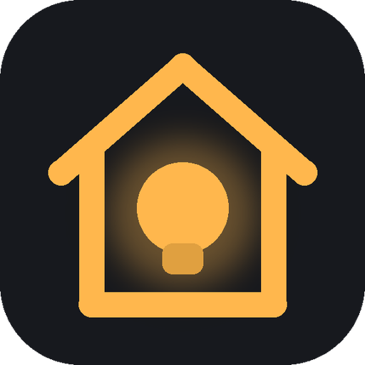

# LightHA

A native Android wall-tablet app for Home Assistant. It draws your **existing HA dashboards** with Kotlin/Compose instead of a WebView, so it stays fast on old tablets (it runs on a 2014 Fire HD 6 with Android 5).

Your HA dashboard is the source of truth. Edit it in HA on your phone, or on the tablet itself, and every screen updates within a second.

## Features

- **Renders HA dashboards natively.** Sections, headings, stacks, grids, card widths (`grid_options.columns`), badges and `visibility` conditions all carry over.
- **Your tap, double-tap and hold actions from HA work the same**, including `confirmation:` prompts and bubble-card pop-ups (`navigate` to `#hash`).
- **More-info sheet** on hold, or wherever HA would open one. It has controls for the entity type: brightness, color temperature and color for lights; target temperature and mode for thermostats; position for covers; transport and volume for media; plus the full attribute list.
- **Media card** with album art (loaded through HA's image proxy, so no internet needed), live progress, controls that match what the player supports, volume, and chips to switch players.
- **Tablet-side editor.** Tap the pencil (top right) to reorder, rename, remove or add cards, then save back to HA. Before saving it re-fetches the dashboard and warns if someone else changed it in the meantime.
- **Edit on your phone.** The pencil sheet shows a QR code that opens the same dashboard in HA's editor.
- **Live reload.** The app listens for HA's `lovelace_updated` event, so a save from anywhere updates the tablet.
- **Multiple views.** Each view gets a tab, and you can swipe between them. Subviews and `navigate` actions work, the app reopens on the last view, and it can return to the first view after a set idle time.
- **Universal remote card**, drawn natively. It honours your `rows` and `custom_actions`, supports hold-to-repeat, has a swipe touchpad and text entry, and sends keys the right way per platform: Fire TV through `androidtv.adb_command`, Apple TV and Android TV through `remote.send_command`.
- **On-tablet settings** (gear icon): HA address and sign-in (account or long-lived token), dashboard, which views show (all are on by default), return-to-first-view timer, keep screen on, fullscreen, brightness, tablet editing on/off, and an optional PIN for settings and editing.
- **View backgrounds:** each view's HA background image, at its opacity.
- **Kiosk mode** (Settings → Kiosk):
  - **Use as home screen:** the Home button and reboots open the dashboard.
  - **Start after reboot:** for when you don't use home-screen mode.
  - **Screensaver:** after a set idle time, at its own brightness. Choose a dim clock that moves every minute to avoid burn-in, the clock with current weather, or any web page full screen (ImmichFrame or another photo frame). Any tap wakes it.
  - **Screen follows an entity:** pick any HA entity (motion, a room's lights, someone home). The screen wakes when it turns on and sleeps when it turns off, including under Android's own screensaver (for example ImmichFrame).
  - **Active hours:** the screen is on only between two times you pick (to the minute, across midnight is fine). Outside them it sleeps, and only the wake word, intercom calls and finished timers wake it. Motion and the followed entity don't. It goes back to sleep after a minute without touches.
  - **Screen off:** turn on **Allow turning the screen off** (LightHA becomes a device admin, used only to switch the screen off) and pick what sleeping means for the followed entity and active hours: **Screensaver** (starts Android's screensaver right away where the ROM allows, otherwise after the system timeout as before) or **Screen off**. Without a PIN, pattern or password the screen wakes straight to the dashboard. Turn the switch off before uninstalling: Android won't uninstall a device admin.
  - **Wake on camera motion:** the tablet's camera compares tiny grayscale snapshots once a second (nothing is saved or sent). Motion wakes the screen, and with **Sensors** on it's reported to HA as a camera motion sensor.
- **Sensors** (Settings → Sensors): the tablet registers as a device through HA's `mobile_app` integration, like the Companion app, and reports battery level, charger plugged in, battery temperature, music volume, camera motion (front or back camera), screen (`on`, `screensaver`, `off`), Wi-Fi signal, light level (on tablets with a light sensor), the current view, app memory and when the app started. Works with any account.
  - **Commands** through `notify.mobile_app_<tablet>`, named like the Companion app's so existing automations work: `command_screen_on`, `command_screensaver`, `command_screen_brightness_level` (`data: {command: 0-255}`, or `auto`), `command_webview` (`data: {command: /lovelace/kitchen}`, opens that view), `command_reload`, `command_keep_screen_on` (`data: {command: turn_on}` or `turn_off`), `command_screen_off` (needs **Allow turning the screen off**, otherwise it starts the screensaver), `command_volume_level` (`data: {media_stream: music_stream, command: 10}`, a step on that stream's own scale, usually 0-15 for music; also `alarm_stream`, `ring_stream`, `notification_stream`, `system_stream`, `call_stream`) and `command_launch_app` (`data: {package_name: <the app's package, the id= in its Play Store link>}`). The music volume is reported as `sensor.<tablet>_volume_music`, in the same steps.
  - **Battery care:** a wall tablet kept at 100% swells its battery. Apps can't stop charging, but a smart plug can, using the battery sensor:

    ```yaml
    triggers:
      - trigger: numeric_state
        entity_id: sensor.<tablet>_battery_level
        above: 80
        id: full
      - trigger: numeric_state
        entity_id: sensor.<tablet>_battery_level
        below: 20
    actions:
      - action: "switch.turn_{{ 'off' if trigger.id == 'full' else 'on' }}"
        target:
          entity_id: switch.<tablet_charger_plug>
    ```
  - **Speak on the tablet:** `message: TTS` with `data: {tts_text: "The washer is done"}`, as with the Companion app. It's spoken in your Assist pipeline's voice and shown in the voice bubble.
  - **Voice timers:** with Sensors on, "set a 10 minute timer" works. Running timers count down in the header (Settings > Voice > Show running timers, on by default). HA keeps the timer, and when it finishes the tablet wakes, rings and shows it with a Stop button. Tablets registered before 0.6.0 need one HA restart first, so HA picks up their push channel.
- **Voice** (Settings → Voice):
  - **Assist button:** tap the mic in the header and talk. HA's Assist pipeline (pick one, or use your default) hears when you stop, the answer shows on screen, and the reply is spoken. The reply starts playing as it streams in, so you hear it about half a second after HA answers (Settings > Voice can switch back to the old player).
  - **Wake word:** Okay Nabu, Hey Jarvis, Hey Mycroft or Hey Luna built in, or any of about 800 more from [Tater Wake Words](https://github.com/TaterTotterson/Tater-Wake-Words) under **More…** (the one you pick downloads once from GitHub, then works offline). Detected on the tablet with [microWakeWord](https://github.com/OHF-Voice/micro-wake-word) (the engine from the HA Companion app). No audio leaves the tablet until the word is heard. The header mic turns amber while it's listening. Sensitivity is adjustable.
  - Some old ROMs crash Android's audio service whenever the mic records (LineageOS 14.1 on the Fire HD 6 does). LightHA notices, switches the mic off, and says so in Settings.
- **Intercom** (Settings → Intercom): tablets call each other on your network, with no server and no HA in the path.
  - **Make calls** and **Receive calls** are separate. A tablet with only Make calls on never opens a port or shows up on other tablets, so it can't be called.
  - **Pairing:** tablets see each other, but only paired tablets can call or announce. Tap a nearby tablet to pair, then accept on the other one once both screens show the same 6-digit code. Remove a pairing any time in Settings.
  - **Encrypted:** pairing is an ECDH key exchange, so the pair key never crosses the network. Every call starts with both tablets proving they hold that key, and the audio is AES-GCM encrypted with a fresh key per call. Unpaired tablets are refused before anything rings.
  - The phone button in the header lists paired tablets, then **Announce to all** (one way, to every paired tablet at once) and, with more than one paired tablet, **Announce to…** to tick just the ones you want, then nearby tablets to pair with. Tap the big button to lock the mic on (tap again to turn it off), or hold it to talk. Both tablets can talk at once.
  - Calls ring with Answer and Decline, or **answer automatically** after a chime and a 3 second countdown. Nothing is sent from a tablet until its talk button is held.
  - **Do not disturb:** on, off, or on a schedule (for example 22:00 until 07:00). Callers see it in their list.
  - The wake word pauses for the whole call, and a call that comes in during an Assist turn gets "busy", so the voice assistant and the intercom never fight over the mic.
  - **From Home Assistant** (needs Sensors on): the tablet reports `sensor.<tablet>_intercom` (`idle`, `pairing`, `calling`, `ringing`, `in_call`, `announcing`, `listening`, `missed`), `sensor.<tablet>_intercom_peer` and `binary_sensor.<tablet>_intercom_do_not_disturb`. Send commands with its notify action:

    ```yaml
    action: notify.mobile_app_<tablet>
    data:
      message: intercom_call   # or intercom_hangup, intercom_answer, intercom_decline, intercom_dnd_on, intercom_dnd_off
      data:
        kiosk: Bedroom         # intercom_call only: the name the other tablet shows
    ```
- **Kiosk basics.** The screen stays on, the app runs fullscreen, and it reconnects with backoff when HA drops.

## Install

1. Download `LightHA-<version>.apk` from [Releases](https://github.com/TheDevRo/LightHA/releases) and install it on the tablet. Android 5.0 or newer.
2. Open LightHA. On first launch it shows Settings: enter your HA address (for example `http://homeassistant.local:8123`), then sign in with your HA username and password (and 2-factor code, if you use one). The tablet keeps only a refresh token; remove it any time under **Profile → Security** in HA.
3. Prefer a long-lived token? Pick **Long-lived token** instead and paste one from **Profile → Security → Long-lived access tokens**.

Non-admin accounts see only the dashboards and views HA shows them, and can't edit from the tablet.

Release APKs contain no server address or token. Everything is entered on the tablet.

## Build from source

Create `local.properties` in the project root. It's gitignored; never commit it.

```properties
sdk.dir=/path/to/android/sdk
# Optional: prefill debug builds so a fresh install connects right away
ha.url=http://homeassistant.local:8123
ha.token=<your long-lived token>
# Optional: release signing (without these, release builds use the debug key)
release.store=/path/to/lightha-release.jks
release.password=<keystore password>
```

Then run `./gradlew installDebug`, or `./gradlew assembleRelease` for a shrunk, signed APK. Needs JDK 17+, Android SDK platform 34, NDK 29.0.14206865 and CMake 4.1.2 (`sdkmanager "ndk;29.0.14206865" "cmake;4.1.2"`). The first build downloads tflite-micro and its dependencies (pinned by hash).

The app opens the dashboard with the URL path `wall-home`. To pick another one, tap the pencil and choose from the list. To edit a dashboard on the tablet, it must be a "wall" copy; the **Make a wall copy to edit here** button makes one. This keeps tablet edits from changing your main dashboards.

## Supported cards

Every card type built into Home Assistant (all 70 in HA 2026.10) is drawn natively; a unit test checks the list against HA's frontend. Highlights:

| HA card | Drawn as |
|---|---|
| `heading`, stacks, `grid`, `conditional`, `entity-filter` | layout and filtering, including legacy `state_filter` and conditions |
| `entities`, `entity`, `tile`, `button`, `light`, `sensor`, `thermostat`, `glance`, `toggle-group`, `shortcut`, `alert` | entity rows, glance cells, toggle chips |
| `media-control` | media card |
| `weather-forecast`, `calendar`, `todo-list`, `shopping-list`, `markdown`, `clock` | forecast, event list or month grid, live to-do list, rendered text |
| `history-graph`, `statistics-graph`, `statistic`, `gauge`, `distribution` | lines for numbers, coloured timelines for states, bars, gauges |
| `picture`, `picture-entity`, `picture-glance`, `picture-elements` | images and camera snapshots with overlays and positioned elements |
| `logbook`, `area`, `home-summary`, `updates`, `alarm-panel`, `humidifier`, `plant-status` | lists, area summary, keypad and controls |
| Energy, water and power cards | today's figures from the Energy dashboard settings |
| `map` | people and places as rows (map tiles need internet) |
| `iframe` | a tile that opens the page full screen |
| `repairs`, `discovered-devices` | admin logins only; hidden otherwise |

Custom cards:

| Card | Drawn as |
|---|---|
| Mushroom: light, entity, template, climate, number, fan, cover, lock, media, vacuum, alarm, select, humidifier, person, update; template badges | entity rows and badges; templates rendered live by HA |
| `custom:yet-another-media-player` | media card |
| `custom:weather-forecast-card`, `custom:calendar-card-pro`, `custom:atomic-calendar-revive` | forecast, calendar |
| `custom:mini-graph-card` | sparkline from long-term statistics |
| `custom:advanced-camera-card` | refreshing snapshots, PTZ arrows |
| `custom:universal-remote-card` | remote |
| `custom:bubble-card` pop-ups | bottom sheet, opened by a `#hash` action |
| `custom:auto-entities` | include/exclude rules and sort, handed to its inner card |
| `custom:uptime-card`, `custom:flex-table-card`, `custom:upcoming-media-card`, `custom:threedy-card`, `custom:power-flow-card-plus` | uptime bar, table, upcoming list, printer status, power rows |

Any other card that names `entity` or `entities` is drawn as entity rows. Cards without entities are skipped; in edit mode they show as outlined placeholders.

Each entity row shows a control that fits the domain: a switch for lights, switches, fans and `input_boolean`; −/+ for thermostats and numbers; play/pause for media; plus covers, locks (asks before locking/unlocking), scenes, scripts, buttons and sensors (timestamps and weather are shown in plain words).

## Not yet

Live camera video · map tiles · cards built from JavaScript templates (`button-card`, `config-template-card`) · `card_mod` on cards other than markdown · mDNS discovery · drag-and-drop editing · speaker grouping and media browsing.

## Project layout

| File | What it does |
|---|---|
| `HaClient.kt` | WebSocket API: auth, live states, service calls, requests, `lovelace_updated` |
| `Lovelace.kt` | dashboard load/save/copy, visibility, action parsing, layout packing, edit operations |
| `Kinds.kt` | maps an entity to its kind, default tap, state text and steppers |
| `Cards.kt`, `Tiles.kt`, `Media.kt` | card dispatch (`rendererOf`), entity rows, media card |
| `NativeCards.kt`, `Graph.kt`, `Energy.kt` | HA's built-in cards |
| `CustomCards.kt` | custom (HACS) cards beyond Mushroom |
| `MoreInfo.kt` | more-info sheet |
| `Editor.kt` | pencil sheet, QR code, edit toolbar, entity picker |
| `Kiosk.kt` | home-screen mode, start on boot, screensaver |
| `Remote.kt` | universal-remote-card and per-platform key dispatch |
| `Settings.kt`, `SettingsScreen.kt` | on-tablet settings |
| `MobileApp.kt` | `mobile_app` registration and sensor reports and commands |
| `Voice.kt` | push-to-talk Assist over the WebSocket, reply overlay and playback |
| `Intercom.kt`, `IntercomCrypto.kt` | tablet-to-tablet calls and announcements: UDP beacon discovery, pairing, authenticated and encrypted TCP audio, call screen |
| `WakeWord.kt`, `cpp/` | on-tablet wake word: JNI wrapper and the native microWakeWord engine (Apache-2.0, see `cpp/NOTICE`) |
| `WakeCatalog.kt` | Tater Wake Words catalog: list, download and cache a model |

The pure logic is covered by JVM unit tests: `./gradlew testDebugUnitTest`.

Debug builds can show a local test dashboard: push a Lovelace config as JSON to the app's `files/gallery.json` (`adb push … /data/local/tmp/` then `run-as home.kiosk cp …`) and set the dashboard to `gallery`. Keep the file out of git (`*.local.json` is ignored), since it holds your entity ids.
